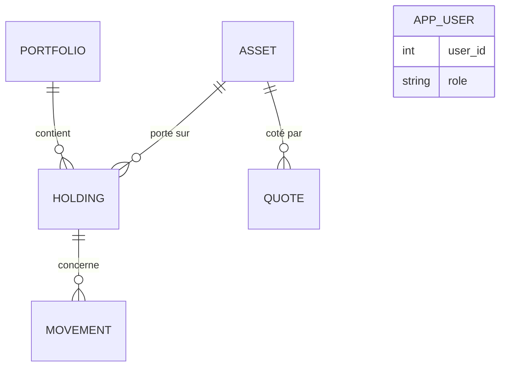

# MCD — PFT v2

Modèle conceptuel de données (Merise) de la base PostgreSQL de PFT v2.
Périmètre : patrimoine financier (portefeuilles, actifs, cotations, mouvements) et comptes d'accès à l'app.
Hors périmètre : les news scrapées, qui vont dans le stockage big data (#22, #25).

Point de départ : le schéma v1 (`db/schema/Create_DB_PFT.sql`, 4 tables). Les changements sont listés en fin de document.

---

## 1. Règles de gestion

| # | Règle |
| :--- | :--- |
| RG1 | Un portefeuille est d'un et un seul type d'enveloppe : `PEA`, `CTO`, `PEE` ou `LIVRET`. Le taux d'imposition de chaque type est dans `settings/config.yaml` (paramètre réglementaire, pas une donnée métier). |
| RG2 | Un actif (ETF, action, fonds, poche cash, livret) existe une seule fois en base, quel que soit le nombre de portefeuilles qui le détiennent. |
| RG3 | Un actif a zéro, une ou plusieurs cotations, au plus une par jour. Une cotation concerne un et un seul actif. |
| RG4 | Une ligne de détention relie un portefeuille et un actif. Un portefeuille contient zéro, une ou plusieurs lignes ; un actif est détenu par zéro, une ou plusieurs lignes ; un même actif n'apparaît qu'une fois par portefeuille. |
| RG5 | Un mouvement concerne une et une seule ligne de détention. Une ligne de détention a zéro, un ou plusieurs mouvements. |
| RG6 | Un mouvement a un et un seul type : `ACHAT`, `VENTE`, `DIVIDENDE`, `APPORT`, `RETRAIT`, `ABONDEMENT`, `INTERET`, `AJUSTEMENT`, `RETRAIT_MIROIR`, `TRANSFERT`. |
| RG7 | Un achat d'ETF génère deux mouvements : l'`ACHAT` sur la ligne du titre, et un `RETRAIT_MIROIR` sur la ligne cash du même portefeuille. Le miroir est exclu des apports. |
| RG8 | Les mouvements PEE sont saisis en `APPORT`, pas en `ACHAT`, pour compter dans les apports. Un `RETRAIT` est un vrai retrait d'argent et impacte la perf marchés. |
| RG9 | La quantité d'un mouvement n'est jamais nulle (positive = entrée, négative = sortie). Le prix d'une cotation est strictement positif. Les frais sont positifs ou nuls. |
| RG10 | Un compte d'accès a un et un seul rôle : `admin` (consultation, saisie, mises à jour) ou `viewer` (consultation seule, utilisé pour la démo). Les comptes ne sont pas rattachés aux portefeuilles : l'app gère un seul patrimoine. |

---

## 2. Dictionnaire de données

| Code | Libellé | Type | Taille | Entité | Remarque |
| :--- | :--- | :--- | :--- | :--- | :--- |
| `user_id` | Identifiant du compte | N | — | APP_USER | Identifiant |
| `email` | Adresse e-mail | AN | 255 | APP_USER | Unique — donnée perso (RGPD, #31) |
| `password_hash` | Empreinte du mot de passe | AN | 255 | APP_USER | Jamais le mot de passe en clair |
| `role` | Rôle | AN | 10 | APP_USER | Domaine : `admin`, `viewer` |
| `created_at` | Date de création du compte | D/H | — | APP_USER | Sert à la purge RGPD |
| `portfolio_id` | Identifiant portefeuille | N | — | PORTFOLIO | Identifiant |
| `portfolio_name` | Nom affiché | AN | 50 | PORTFOLIO | Ex. « PEA », « PEE STEF » |
| `institution_name` | Établissement | AN | 50 | PORTFOLIO | Ex-`ptf_nom_banque` |
| `wrapper_type` | Type d'enveloppe | AN | 10 | PORTFOLIO | Domaine : `PEA`, `CTO`, `PEE`, `LIVRET` (RG1) |
| `is_active` | Portefeuille ouvert | B | — | PORTFOLIO | Ex-`ptf_est_actif` |
| `asset_id` | Identifiant actif | N | — | ASSET | Identifiant |
| `asset_name` | Nom de l'actif | AN | 100 | ASSET | Ex-`pdt_nom_produit` |
| `ticker` | Code de cotation | AN | 20 | ASSET | Optionnel (pas de ticker pour un fonds PEE ou le cash) — unique s'il est renseigné |
| `is_cash` | Actif monétaire | B | — | ASSET | Ex-`pdt_cash` : poche cash, livret (prix implicite = 1) |
| `quote_id` | Identifiant cotation | N | — | QUOTE | Identifiant |
| `quote_date` | Date de cotation | D | — | QUOTE | Unique avec l'actif (RG3) |
| `price` | Prix | N | 12,6 | QUOTE | > 0 |
| `holding_id` | Identifiant ligne de détention | N | — | HOLDING | Identifiant — joue le rôle de l'ancien `pdt_id` dans les vues |
| `is_active` | Ligne encore détenue | B | — | HOLDING | Ex-`pdt_est_actif` |
| `movement_id` | Identifiant mouvement | N | — | MOVEMENT | Identifiant |
| `movement_date` | Date du mouvement | D | — | MOVEMENT | |
| `movement_type` | Type de mouvement | AN | 20 | MOVEMENT | Domaine : voir RG6 |
| `quantity` | Quantité (parts ou montant cash) | N | 15,6 | MOVEMENT | ≠ 0 (RG9) — ex-`mvt_nb_parts` |
| `unit_price` | Prix unitaire | N | 12,6 | MOVEMENT | Ex-`mvt_prix` (était en 8,4 : trop juste) |
| `fees` | Frais | N | 8,2 | MOVEMENT | ≥ 0, défaut 0 |

Types : N = numérique, AN = alphanumérique, D = date, D/H = date et heure, B = booléen.
Les valeurs des domaines (types d'enveloppe, de mouvement, rôles) sont en français ou en sigles, telles qu'affichées dans l'app : seuls les identifiants (tables, colonnes, code) sont en anglais.

---

## 3. Entités et associations

**Entités**

| Entité | Identifiant | Propriétés |
| :--- | :--- | :--- |
| APP_USER | `user_id` | `email`, `password_hash`, `role`, `created_at` |
| PORTFOLIO | `portfolio_id` | `portfolio_name`, `institution_name`, `wrapper_type`, `is_active` |
| ASSET | `asset_id` | `asset_name`, `ticker`, `is_cash` |
| QUOTE | `quote_id` | `quote_date`, `price` |
| HOLDING | `holding_id` | `is_active` |
| MOVEMENT | `movement_id` | `movement_date`, `movement_type`, `quantity`, `unit_price`, `fees` |

**Associations et cardinalités**

| Association | Entité A (card.) | Entité B (card.) | Lecture |
| :--- | :--- | :--- | :--- |
| CONTENIR | PORTFOLIO (0,n) | HOLDING (1,1) | Un portefeuille peut être vide (tout juste ouvert) ; une ligne appartient à un seul portefeuille. |
| PORTER_SUR | ASSET (0,n) | HOLDING (1,1) | Un actif peut exister sans être détenu (ex. un indice de référence, coté mais pas acheté) ; une ligne porte sur un seul actif. |
| COTER | ASSET (0,n) | QUOTE (1,1) | Un actif peut n'avoir aucune cotation (cash, livret) ; une cotation concerne un seul actif. |
| CONCERNER | HOLDING (0,n) | MOVEMENT (1,1) | Une ligne peut exister avant son premier mouvement ; un mouvement concerne une seule ligne. |

Les quatre associations sont binaires, sans propriété, de type (0,n)–(1,1) : chacune deviendra une clé étrangère au MLD.
APP_USER n'est reliée à aucune autre entité (voir § 4).

---

## 4. Choix de modélisation

**Pourquoi séparer ASSET et HOLDING (le gros changement de la v2).**
En v1, un produit appartient à un portefeuille. Le même ETF détenu dans deux enveloppes (cas courant, ex. un ETF Monde en PEA et en CTO) serait créé deux fois, et ses cotations dupliquées. En v2, l'actif et ses cotations existent une seule fois (RG2, RG3), et la ligne de détention dit « qui le possède où ».

**Pourquoi HOLDING est une entité, et pas une simple association PORTFOLIO–ASSET.**
La détention porte une donnée (`is_active`) et surtout, les mouvements doivent s'y rattacher. En Merise, une association ne peut pas être reliée à une autre association : il faut donc en faire une entité. Elle reprend le rôle de l'ancienne table `produit_financier_pdt` (« un produit dans un portefeuille »), ce qui limite la réécriture des vues (#18).

**Pourquoi les types (enveloppe, mouvement, rôle) sont des domaines de valeurs, et pas des entités.**
Ce sont des listes courtes et stables, qui ne portent aucune autre donnée. Une table de référence n'apporterait rien de plus qu'une contrainte `CHECK`, qui est plus simple. Côté code, l’Enum MovementType de core/constants.py reprend les mêmes codes français (termes métier sans équivalent clair en anglais : abondement, retrait miroir…) ; le test de #9 vérifie que l’Enum et le CHECK restent synchronisés.

**Pourquoi le taux d'imposition n'est pas en base.**
C'est un paramètre réglementaire, qui change par la loi et pas par l'usage de l'app : il va dans `settings/config.yaml`, indexé par type d'enveloppe (#4). La base ne stocke que le type d'enveloppe de chaque portefeuille.

**Pourquoi APP_USER, et pourquoi isolée.**
Le REAC exige une authentification sur l'API données (C5) et l'API modèle (C9), et une gestion des droits d'accès dans l'app, couverte par des tests (C17). Deux rôles suffisent : `admin` pour la saisie et les mises à jour, `viewer` pour la consultation, qui sert aussi de compte de démo. APP_USER n'est reliée à rien : rattacher les portefeuilles à un propriétaire rendrait l'app multi-utilisateur et obligerait à filtrer chaque vue et chaque requête par utilisateur, sans besoin réel. C'est aussi la donnée personnelle de référence du registre RGPD (#31). Le nom `APP_USER` évite `user`, mot réservé de PostgreSQL.

**Pourquoi l'établissement reste un attribut de PORTFOLIO.**
Aucune donnée propre à l'établissement n'est utilisée par l'app. En faire une entité serait de la normalisation sans usage.

**Pourquoi la cotation garde un identifiant technique.**
`(asset_id, quote_date)` pourrait servir d'identifiant, mais un identifiant technique simplifie les jointures et les ETL. L'unicité métier est garantie par une contrainte `UNIQUE` (RG3).

---

## 5. Changements par rapport à la v1

- Noms de tables et de colonnes en anglais, sans préfixe (`pdt_`, `ptf_`…) ni majuscules. Les valeurs stockées (types de mouvement, d'enveloppe) ne changent pas.
- `produit_financier_pdt` est éclaté en ASSET (l'actif) et HOLDING (sa détention dans un portefeuille). Les cotations sont rattachées à l'actif.
- Nouvelle entité APP_USER (authentification et rôles), indépendante du patrimoine.
- `ptf_type_enveloppe` (texte libre) devient `wrapper_type` avec un domaine de valeurs contrôlé.
- `mvt_prix` passe de `DECIMAL(8,4)` à `NUMERIC(12,6)`, comme le prix des cotations.
- Contrainte en double `UNIQUE (pdt_id, cot_date)` supprimée : une seule `UNIQUE (asset_id, quote_date)` subsiste.
- Unicités : une ligne par couple (portefeuille, actif) ; ticker unique s'il est renseigné. L'ancienne `UNIQUE (banque, type d'enveloppe)` disparaît : rien n'empêche deux PEE chez deux employeurs.

---

## 6. Aperçu (non Merise)

Diagramme de prévisualisation, rendu automatiquement par GitHub. La notation est entité-relation (pattes de corbeau), **pas** le formalisme Merise : le MCD officiel est celui de Looping, exporté dans `docs/`.

